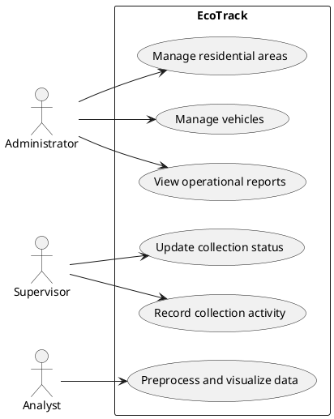
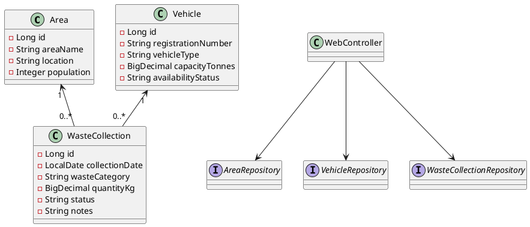

# System design
## Architecture
```text
Browser (Thymeleaf HTML/CSS)
        |
        v
Spring MVC Controller (WebController)
        |
        v
Spring Data JPA Repositories
        |
        v
PostgreSQL (areas, vehicles, waste_collections)
        ^
        | SQL read-only retrieval
Python analysis (pandas + matplotlib)
        |
        v
Clean CSV + PNG charts
```

## Use-case diagram (PlantUML)


## Class diagram (PlantUML)


## Business rules
1. Area names and vehicle registration numbers are unique.
2. Population, capacity and collection quantity must be positive.
3. Each collection references an existing area and vehicle.
4. A collection quantity must not exceed selected vehicle capacity converted to kilograms.
5. Status is one of Pending, In Progress or Completed.
